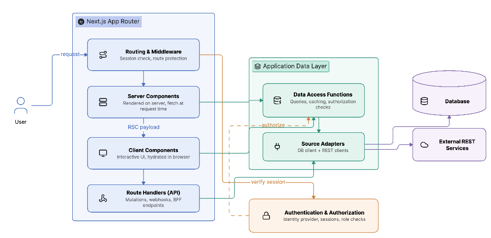

# Fitness Companion Architecture

Forma is a private fitness companion for planning workouts, following routines, and tracking personal progress. It is deliberately focused on the individual user and does not include feeds, followers, likes, or public profiles.

## System overview



The diagram describes the main technical boundaries:

- **Next.js App Router** handles routing, layouts, Server Components, Client Components, and API route handlers.
- **Auth.js** provides Google authentication and database-backed sessions.
- **The application data layer** owns database queries, mutations, authorization checks, and external-service access.
- **PostgreSQL** stores users, routines, workouts, measurements, and progress-entry metadata.
- **Object storage** stores progress-photo files; PostgreSQL stores their URLs and related metadata.
- **An external exercise API** supplies exercise names, muscle groups, equipment, and other reference data.

The diagram’s routing and middleware layer is conceptual. In the implementation, the `(protected)` layout should verify that a session exists, while the data-access layer performs the record-level authorization checks. A global Next.js proxy can support session handling, but it should not be the only authorization boundary.

## Architectural principles

### Server-first rendering

Use Server Components by default for pages and data retrieval. Use Client Components only where browser interaction is required, such as:

- workout logging controls;
- drag-and-drop reordering;
- timers;
- charts;
- photo comparison controls;
- modals and slide-up panels.

### Centralised data access

Pages and components should not contain raw database queries. Database operations should live in a dedicated data-access layer that is responsible for:

- validating input;
- checking the authenticated user;
- confirming that requested records belong to that user;
- executing queries and mutations;
- returning application-friendly results.

### User-owned data

Every private fitness record must belong to an authenticated user. Server-side operations obtain the user ID from the Auth.js session rather than trusting a `userId` received from the browser.

### Stable workout history

Completed workouts are historical records. Editing or deleting a routine must not rewrite or remove workouts that have already been completed. Exercise names and performed sets should be copied into the completed workout record so history remains meaningful even if the routine or external API changes later.

## Authentication flow

1. A visitor opens the application and sees the authentication card.
2. The visitor selects **Continue with Google**.
3. Auth.js signs in an existing user or creates a new account on first login.
4. A new user is directed to the dashboard onboarding state.
5. A returning user is directed to their normal dashboard.

Because authentication is currently Google-only, **Log in** and **Create account** use the same OAuth process. Forma does not store or reset Google passwords.

## Application navigation

The authenticated application contains these main destinations:

- Dashboard
- Routines
- Workout History
- Progress
- Measurements
- Profile

Desktop can use a sidebar or header navigation. Mobile should use a compact header, menu.

## Product areas

### Dashboard

The dashboard provides a concise overview rather than a large analytics screen.

It includes:

- the number of workouts completed this month;
- the active routine;
- the next scheduled workout;
- recent completed workouts;
- the latest measurement update;
- onboarding prompts when the user has no routine or measurements yet.

### Profile

The profile area allows the user to:

- change their display name;
- choose `kg` or `lb`;
- choose `cm` or `inches`;
- log out;
- delete their account.

Password management is not required while Google is the only authentication provider.

### Routines

The routines page shows:

- the active routine;
- all other available routines;
- routine name, description, and number of workout days;
- actions to create, edit, activate, or delete a routine.

Only one routine can be active for a user at a time.

#### Routine builder

When creating or editing a routine, the user can:

- enter a routine name and description;
- add workout sessions;
- rename, remove, and reorder workout sessions;
- add exercises to each workout;
- remove or reorder exercises.

Selecting **Add exercise** opens a searchable exercise picker. Exercises can be filtered by name, muscle group, and equipment.

After selecting an exercise, the user can configure:

- number of sets;
- target reps;
- optional target weight;
- rest time;
- notes.

### Active workout

The active workout screen is mobile-first and optimised for quick use at the gym.

For each exercise, it shows:

- previous performance;
- today’s weight and reps for each set;
- set completion controls;
- rest timer;
- notes;
- add-set and next-exercise actions.

Finishing the workout creates a permanent completed-workout record.

### Workout history

Workout history contains all completed workouts, grouped by month and date—not only workouts from the previous month.

Opening a completed workout shows:

- workout name and date;
- duration;
- exercises performed;
- sets, reps, and weight;
- workout and exercise notes.

Historical workout pages are read-only.

### Progress photos

The progress area contains a timeline or gallery of progress entries.

The user can create an entry containing:

- date, initially set to today but editable;
- optional weight;
- optional notes;
- front photo;
- side photo;
- back photo.

Existing entries can be opened, reviewed, edited, or deleted.

#### Compare progress

The comparison screen allows the user to select:

- a **Before** progress entry;
- an **After** progress entry;
- **Front**, **Side**, or **Back** view.

Photos are displayed at consistent dimensions and crop settings. The initial version can use side-by-side photos; an interactive comparison slider can be added later.

### Measurements

The measurements page shows the latest values and measurement history.

Supported measurements are:

- weight;
- waist;
- chest;
- hips;
- arm;
- thigh.

Weight is selected by default. Filter controls allow the user to switch the chart and history between measurement types.

Selecting the add button opens a mobile-friendly slide-up panel containing:

- date, initially set to today but editable;
- weight;
- waist;
- chest;
- hips;
- arm;
- thigh;
- save action.

Users can also delete an incorrect measurement entry.

## Route structure

```text
src/app/
├── (auth)/
│   ├── login/page.tsx
│   └── create-account/page.tsx
├── (protected)/
│   ├── layout.tsx
│   ├── dashboard/page.tsx
│   ├── routines/
│   │   ├── page.tsx
│   │   ├── new/page.tsx
│   │   └── [routineId]/
│   │       ├── edit/page.tsx
│   │       └── workouts/[workoutId]/page.tsx
│   ├── workout/[workoutId]/page.tsx
│   ├── history/
│   │   ├── page.tsx
│   │   └── [workoutId]/page.tsx
│   ├── progress/
│   │   ├── page.tsx
│   │   ├── compare/page.tsx
│   │   └── photos/
│   │       ├── new/page.tsx
│   │       └── [entryId]/page.tsx
│   ├── measurements/page.tsx
│   └── profile/page.tsx
└── api/
    └── auth/[...nextauth]/route.ts
```

Route groups such as `(auth)` and `(protected)` organise the application without appearing in its URLs.

## Important data decisions

- Store structured application data in PostgreSQL.
- Store progress-photo files in object storage and keep only their URLs and metadata in PostgreSQL.
- Preserve completed workout history when routines are edited or deleted.
- Store a local exercise snapshot with routines and completed workouts so external API changes do not corrupt existing data.
- Treat measurement history as the canonical source for body measurements. A progress entry may optionally reference or snapshot the user’s weight for that date.
- Apply ownership and authorization checks in the data-access layer for every query and mutation.

## implementation order

1. Authentication and protected application layout
2. User profile and unit preferences
3. Routine and workout builder
4. Active workout logging
5. Completed workout history
6. Measurements and charts
7. Progress-photo upload and gallery
8. Before-and-after photo comparison
