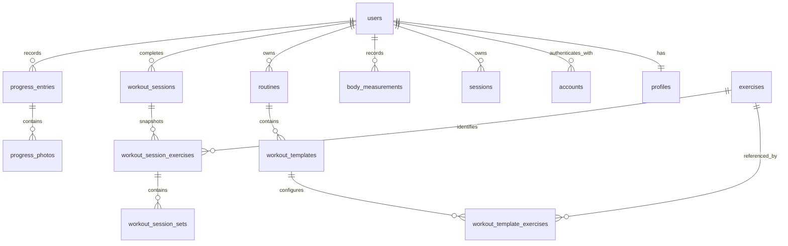

# Forma

Forma is a mobile-first fitness companion for planning routines, logging workouts,
tracking body measurements, and comparing private progress photos.

The application is a full-stack Next.js App Router project. Reads are performed in
authenticated Server Components, writes use Server Actions, structured data is
stored in Neon Postgres through Drizzle ORM, and private progress photos are stored
in Vercel Blob.

## Features

- Google authentication with database-backed sessions.
- Five-account private-testing limit with unrestricted access for existing users.
- Public browser-only prototype mode with seeded interactive data.
- User profiles with configurable weight and body-measurement units.
- Routine creation, editing, activation, deletion, and drag-and-drop ordering.
- Strength and cardio exercise support.
- Active workout drafts persisted in browser storage.
- Rest timer, previous exercise performance, and short performance messages.
- Completed-workout history with exercise and set details.
- Weight and body-measurement history with trends and charts.
- Private front, side, and back progress-photo galleries.
- Side-by-side photo comparison with touch zoom and pan.
- Route-level loading skeletons, image loading states, and a styled 404 page.
- Responsive layouts designed primarily for mobile use.

> Forma is not currently configured as an installable PWA. Service-worker support,
> offline behaviour, and lock-screen timer integration are future work.

## Technology stack

| Area | Technology |
| --- | --- |
| Framework | Next.js 16 App Router |
| UI | React 19, TypeScript, Tailwind CSS 4 |
| Authentication | Auth.js / NextAuth v5 with Google OAuth |
| Database | Neon Postgres |
| ORM and migrations | Drizzle ORM and Drizzle Kit |
| File storage | Private Vercel Blob store |
| Drag and drop | dnd-kit |
| Testing | Vitest, Testing Library, jsdom |
| Deployment | Vercel |
| CI | GitHub Actions |

## Architecture

Forma uses feature-oriented folders inside a conventional layered structure.

```text
Browser
  ├─ Public prototype
  │    └─ seeded state persisted only in localStorage
  ├─ Server-rendered route
  │    └─ authenticated data function
  │         └─ server-only database query
  └─ Interactive Client Component
       └─ Server Action or API route
            ├─ authenticate user
            ├─ validate and normalize input
            ├─ perform user-scoped database/storage mutation
            └─ revalidate affected routes and optionally redirect
```

### Rendering boundaries

- Route `page.tsx` files are Server Components unless interaction requires a
  Client Component.
- Server Components authenticate and fetch data before passing serializable props
  to client-side feature structures.
- Interactive components own temporary UI state such as open modals, selected
  tabs, workout drafts, drag state, image transforms, and optimistic feedback.
- `loading.tsx` files form Suspense boundaries for route transitions.
- The protected route group has a general skeleton, while History and Routines
  have page-specific skeletons.
- `src/app/not-found.tsx` provides the global styled 404 state.

### Read flow

Feature reads normally follow this path:

```text
src/app/(protected)/<feature>/page.tsx
  → src/app/(protected)/<feature>/data.ts
  → src/db/<feature>.ts
  → Neon Postgres
```

`data.ts` is the authenticated boundary. Database modules are marked
`server-only` where appropriate and should not be imported into Client Components.

### Mutation flow

Feature mutations normally follow this path:

```text
Client form or control
  → src/app/(protected)/<feature>/actions.ts
  → src/validation/<feature>.ts
  → src/db/<feature>.ts
  → revalidatePath(...)
  → optional redirect(...)
```

Every mutation authenticates again on the server. Client-provided user IDs are not
trusted as ownership checks.

## Repository structure

```text
fitness-comparison-app/
├── .github/workflows/       Pull-request test workflow
├── drizzle/                 Versioned SQL migrations and Drizzle metadata
├── public/                  Static assets, including the Forma logo
├── src/
│   ├── app/
│   │   ├── (auth)/          Login and account-creation routes
│   │   ├── (protected)/     Authenticated application routes
│   │   ├── api/             Auth and private progress-photo endpoints
│   │   ├── globals.css      Design tokens and global component styles
│   │   ├── layout.tsx       Root document layout and metadata
│   │   ├── loading.tsx      Root loading state
│   │   └── not-found.tsx    Global 404 page
│   ├── components/
│   │   ├── auth/            Authentication screens
│   │   ├── dashboard/       Dashboard cards and active-workout selection
│   │   ├── layout/          Header, menu, icons, controls, and skeletons
│   │   ├── measurements/    Measurement modal, tabs, history, and charts
│   │   ├── progress/        Upload, gallery, comparison, and photo rendering
│   │   ├── routines/        Routine forms, workout builder, and exercise picker
│   │   └── workouts/        Interactive workout experience
│   ├── db/                  Drizzle client, schema, queries, and seed scripts
│   ├── helpers/             Storage, conversion, formatting, and pure utilities
│   ├── types/               Shared domain and UI types
│   ├── validation/          Input parsing, validation, and normalization
│   └── auth.ts              Auth.js configuration
├── drizzle.config.ts        Drizzle Kit configuration
├── next.config.ts           Next.js configuration
├── vitest.config.ts         Test configuration
└── package.json             Scripts and dependencies
```

## Routes

### Public and authentication routes

| Route | Purpose |
| --- | --- |
| `/` | Resolves the session and redirects authenticated users to the dashboard |
| `/login` | Google sign-in screen |
| `/create-account` | Account-creation entry point using Google authentication |
| `/prototype` | Public interactive demo using seeded browser-only data |
| `/api/auth/[...nextauth]` | Auth.js handlers and OAuth callbacks |

### Protected routes

All routes inside `src/app/(protected)` require an authenticated session in the
route-group layout.

| Route | Purpose |
| --- | --- |
| `/dashboard` | Active routine, monthly summary, recent workouts, and latest measurements |
| `/routines` | List, activate, edit, or delete routines |
| `/routines/new` | Build a new routine and its workouts |
| `/routines/[routineId]/edit` | Edit a user-owned routine |
| `/workouts/[workoutId]` | Run an interactive workout from a workout template |
| `/history` | Show completed workout summaries grouped by month |
| `/history/[sessionId]` | Show a completed workout with exercises and sets |
| `/measurements` | Log, view, chart, and delete body measurements |
| `/progress` | Add, browse, compare, and delete progress-photo entries |
| `/profile` | Update display name and preferred units |

### Progress-photo API routes

| Route | Purpose |
| --- | --- |
| `POST /api/progress-photos/upload` | Authenticate and issue a scoped Blob upload token |
| `GET /api/progress-photos/[photoId]` | Authenticate ownership and stream a private Blob photo |

## Feature boundaries

### Authentication and profiles

`src/auth.ts` configures Auth.js with Google, the Drizzle adapter, database sessions,
and automatic profile creation for new users.

Before Auth.js creates a new user, `src/db/userAccess.ts` checks the number of user
records. Existing users are always permitted to return. New users are rejected when
the configured account limit has been reached and are directed to prototype mode.
The default limit is ten accounts.

The protected layout redirects unauthenticated requests to `/`. Authenticated
queries and actions also check `session.user.id`; the layout alone is not treated
as the security boundary.

Profiles store display names and unit preferences. Physical values are stored
canonically and converted only at input/output boundaries:

- Weight is stored in kilograms.
- Body dimensions are stored in centimetres.
- User-entered `lb` and `in` values are normalized before persistence.

### Prototype mode

`/prototype` is deliberately outside the protected route group. It does not create
an Auth.js session and cannot call authenticated actions or private Blob routes.

The prototype includes seeded dashboard, routine, workout, history, measurement,
and progress-comparison states. Interactions are saved under `forma:prototype:v1`
in the visitor's `localStorage`. Visitors can reset the prototype at any time.
Prototype mode does not upload photos or write to Neon.

### Routines and workout templates

A routine belongs to one user and contains ordered workout templates. Each template
contains ordered configured exercises with targets such as sets, reps, weight, and
rest duration.

The routine builder is a Client Component because it manages nested editing and
drag-and-drop state. On submission, the structure is serialized, validated on the
server, converted to canonical units, and written with ordered database batches.

Only one routine can be active for a user. A partial unique database index protects
this rule in addition to the application logic.

### Active workouts and history

An active workout begins as a browser-side draft containing a version number, the
workout snapshot, session timing, exercise sets, completion state, selected
exercise, and rest-timer end time.

The draft is stored under `forma:active-workout:v1` in `localStorage`. Invalid or
unreadable drafts are removed. The draft is retained when saving fails and removed
after a successful save or confirmed discard.

Completing a workout sends normalized data to `completeWorkoutAction`. The server
creates immutable workout, exercise, and set snapshots. History therefore remains
readable when the original routine is later edited or removed.

### Measurements

Measurement entries are unique per user and date. Saving an existing date updates
that entry. At least one measurement is required, and all supplied values must be
positive.

Supported fields are weight, waist, chest, hips, thigh, and arm. The dashboard
shows a compact latest summary; the Measurements page provides field tabs,
differences, history, and chart data.

### Progress photos

A progress entry belongs to one user and one date. It may contain one photo for each
supported view: `front`, `side`, and `back`.

Upload flow:

1. The browser requests a signed upload token from the upload API route.
2. The API authenticates the user and limits the key to
   `progress-photos/<userId>/...`.
3. Vercel Blob receives the file directly from the browser.
4. The Server Action validates the uploaded Blob metadata.
5. Only the storage key and photo metadata are saved in Postgres.

Accepted formats are JPEG, PNG, and WebP, with a maximum size of 10 MB per photo.
The Blob store is private. Reads go through the photo API route, which verifies the
photo belongs to the authenticated user before streaming it.

Deleting a progress entry removes its database record first and then attempts Blob
cleanup. A Blob cleanup failure is logged without restoring an already deleted user
record.

## Database model

The schema is defined in `src/db/schema.ts`.



### Main tables

| Table | Responsibility |
| --- | --- |
| `users`, `accounts`, `sessions`, `verification_tokens` | Auth.js identity and sessions |
| `profiles` | Display name and unit preferences |
| `body_measurements` | Canonical measurements, unique per user/date |
| `routines` | User-owned routine metadata and active status |
| `workout_templates` | Ordered workouts within routines |
| `exercises` | Searchable exercise catalogue |
| `workout_template_exercises` | Exercise targets and order within a template |
| `workout_sessions` | Completed workout snapshots |
| `workout_session_exercises` | Completed exercise snapshots |
| `workout_session_sets` | Completed set values |
| `progress_entries` | Dated progress-photo records |
| `progress_photos` | Private Blob storage keys and photo views |

Foreign keys, checks, unique constraints, and indexes enforce ownership relations,
positive values, ordering, one entry per date, one photo per view, and common query
paths.

## Design system

Global design tokens live in `src/app/globals.css`. Components should use semantic
classes instead of unrelated raw colours or shapes.

- Surfaces: `bg-canvas`, `bg-surface`, `bg-surface-subtle`.
- Text: `text-primary`, `text-secondary`, `text-inverse`.
- Brand/state: `text-brand`, `bg-brand-soft`, `text-danger`.
- Shape: `rounded-control`, `rounded-card`, `rounded-panel`.
- Elevation: `shadow-card`, `shadow-floating`, `shadow-drawer`.
- Typography: `font-display`, `font-sans`, `font-mono`.

Shared controls and icons are in `src/components/layout/actionComponents`. Loading
skeletons are centralized in `src/components/layout/pageLoadingSkeletons.tsx`.

## Local development

### Prerequisites

- Node.js 24, matching the GitHub Actions environment.
- npm.
- A Neon Postgres database.
- A Google OAuth application.
- A Vercel project with a private Blob store.

### Install and run

```bash
npm ci
npm run dev
```

Open [http://localhost:3000](http://localhost:3000).

### Environment variables

Secrets belong in `.env.local` and must not be committed.

| Variable | Purpose |
| --- | --- |
| `DATABASE_URL` | Neon connection string used by the app and Drizzle Kit |
| `AUTH_SECRET` | Auth.js signing/encryption secret |
| `AUTH_GOOGLE_ID` | Google OAuth client ID |
| `AUTH_GOOGLE_SECRET` | Google OAuth client secret |
| `AUTH_ACCOUNT_LIMIT` | Optional maximum account count; defaults to `10` |
| `BLOB_STORE_ID` | Connected private Vercel Blob store |
| `BLOB_READ_WRITE_TOKEN` | Local Blob access for token-based development |

Vercel and Neon integrations may add additional `POSTGRES_*`, `PG*`,
`DATABASE_URL_UNPOOLED`, `NEON_*`, `VERCEL_OIDC_TOKEN`, or
`BLOB_WEBHOOK_PUBLIC_KEY` variables. The app database client directly uses
`DATABASE_URL`; do not manually expose or rotate integration variables unless the
integration instructions require it.

Pull Vercel development variables with:

```bash
vercel env pull .env.development.local
```

Google OAuth must include these authorized redirect URIs:

```text
http://localhost:3000/api/auth/callback/google
https://<production-domain>/api/auth/callback/google
```

Add preview callback URLs only when authentication is intentionally enabled there.

## Database workflow

The SQL migrations under `drizzle/` are the source of database history. Do not edit
an already applied migration.

After changing `src/db/schema.ts`:

```bash
npm run db:generate
npm run db:migrate
```

Open Drizzle Studio:

```bash
npm run db:studio
```

Seed the exercise catalogue:

```bash
npm run db:seed:exercises
```

The seed imports a filtered strength catalogue from `free-exercise-db` and adds
Forma-specific cardio and bodyweight exercises. Inserts are idempotent by external
exercise ID.

## Scripts

| Command | Purpose |
| --- | --- |
| `npm run dev` | Start the Next.js development server |
| `npm run build` | Create a production build |
| `npm run start` | Run the production server |
| `npm run lint` | Run ESLint with Next.js Core Web Vitals rules |
| `npm test` | Run Vitest in watch/development mode |
| `npm run test:run` | Run the test suite once |
| `npm run test:coverage` | Run tests with V8 coverage |
| `npm run db:generate` | Generate a migration from schema changes |
| `npm run db:migrate` | Apply pending migrations |
| `npm run db:studio` | Open Drizzle Studio |
| `npm run db:seed:exercises` | Import the exercise catalogue |

## Testing and CI

Tests are colocated with the code they cover using `*.test.ts` and `*.test.tsx`.

- Pure validation and conversion utilities are tested without rendering.
- Client interactions use Testing Library and `user-event`.
- Server Actions, authenticated data functions, and photo API routes mock external
  boundaries such as authentication, database access, and Blob storage.
- `vitest.setup.ts` installs shared jsdom matchers and setup.

GitHub Actions runs `npm run test:run` for pull requests targeting `develop` or
`main`. Configure this workflow as a required status check before allowing merges.

Before opening a pull request, run:

```bash
npm run lint
npm run test:run
npm run build
```

## Deployment

The application is deployed on Vercel. The current project uses `develop` as its
production deployment branch.

Before deploying:

1. Connect the Neon database and private Blob store to the Vercel project.
2. Configure Auth.js and Google OAuth variables for the required environments.
3. Add the production callback URL to the Google OAuth client.
4. Apply database migrations to the target database.
5. Redeploy after changing environment variables or rotating integration secrets.

Vercel automatically builds commits pushed to the configured deployment branch.
Preview deployments should use isolated or deliberately shared data according to
the testing plan.

## Adding or changing a feature

Use the existing boundaries consistently:

1. Add or update domain types in `src/types`.
2. Add pure parsing and validation in `src/validation`.
3. Change `src/db/schema.ts` and generate a migration when persistence changes.
4. Add user-scoped queries in `src/db`.
5. Add authenticated read wrappers in the feature `data.ts`.
6. Add authenticated Server Actions in the feature `actions.ts`.
7. Keep the route page server-rendered and move only interactive state into a
   Client Component.
8. Revalidate every route that displays mutated data.
9. Add loading, empty, error, and confirmation states.
10. Add tests at validation, server-boundary, and interaction levels.

### Security checklist

- Authenticate inside every data wrapper, action, upload handler, and private read.
- Scope every user-owned query by authenticated user ID.
- Validate UUIDs and structured payloads before querying.
- Never trust Blob keys or content metadata supplied by the client.
- Keep database and Blob modules out of client bundles.
- Normalize units before persistence.
- Use database constraints for important integrity rules.
- Revalidate dependent pages after mutations.

## Current performance structure

- Dashboard data sources are fetched concurrently.
- Next.js links prefetch primary navigation destinations.
- Route-specific Suspense skeletons provide transition feedback.
- Progress photos have per-image loading and failure states.
- Private photos are streamed with `Cache-Control: private, no-store`.

The main future opportunities are request-scoped session/profile deduplication,
independently streamed dashboard sections, photo thumbnails and compression,
private browser caching, client-component code splitting, and cursor pagination for
growing history collections.
